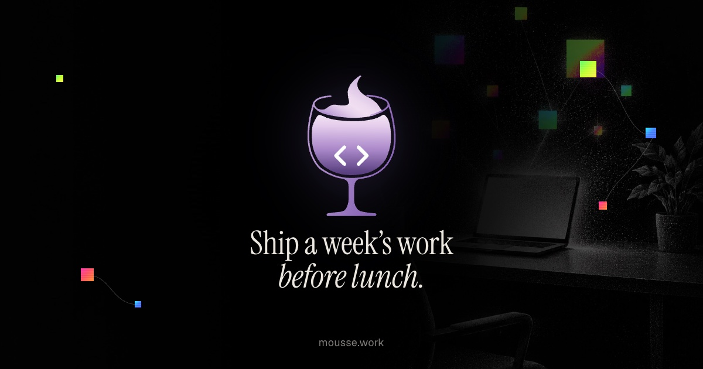

<p align="center">
  
</p>

<h1 align="center">Mousse</h1>

<p align="center">
  <strong>Your agents, always on. Reach them from any machine, any chat, any hour.</strong>
</p>

<p align="center">
  <a href="https://github.com/mousse-agent/mousse/releases"><strong>Download</strong></a> ·
  <a href="https://mousse.work">Website</a> ·
  <a href="docs/">Docs</a>
</p>

Mousse is a free desktop app for owning your agents. They run on your machines, with your keys, and you reach them from wherever you are. Start a job at your desk, check on it from your phone, let it run overnight on the box with the GPU. The agents stay where your code is. You don't have to.

It drives Claude Code, Codex, Google Antigravity, and any agent that speaks [ACP](https://agentclientprotocol.com), and can also run on an API key from Anthropic, OpenAI, Grok, Amazon Bedrock, or Google Vertex AI.

## Why Mousse

Chat apps for agents already exist. They stop at the edge of your laptop.

Mousse doesn't. Link your machines and every thread, on any of them, shows up in one list. Message your agents from Telegram or Discord. Put a bot into a Space with your teammates, and it answers them using your machine and your keys. Schedule the boring work for 3 a.m. and turn the things you do every week into workflows you run with one message.

It is for your teammates too. A Space is a chat where people and bots sit together, so the conversation about the work and the work itself happen in one place. One subscription on one machine can serve a whole small team, because the bots run on their owner's computer with the owner's keys. The goal is simple: you open Mousse in the morning and never have to leave it.

All of it lives in the same window: the threads, the bots, the schedules, and the diffs they produce. Your code and your keys never leave your machines.

And it is yours to keep. No paywalls, no device limits, no feature behind a plan. It is MIT licensed, so you can run it on every machine you own, hand it to your whole team, and fork it the day you disagree with us. We are building it to still work in ten years, not to lock you in next quarter.

## Install

Download the latest build for Windows, macOS, or Linux from [GitHub Releases](https://github.com/mousse-agent/mousse/releases). Nightlies ship daily as prereleases. The macOS builds are not notarized yet, so on first launch choose **Open Anyway** in System Settings → Privacy & Security.

Then install and sign in to at least one agent CLI, such as [Claude Code](https://claude.com/product/claude-code) or [Codex](https://developers.openai.com/codex/cli), add it under **Settings → Providers**, point Mousse at a repo, and hand off the work.

Mousse is early. Expect bugs, and please report them.

## Build from source

Requires Node 24 and Git.

```bash
git clone https://github.com/mousse-agent/mousse.git
cd mousse
npm install
npm run dev
```

The [docs](docs/) cover [architecture](docs/ARCHITECTURE.md), [configuration](docs/CONFIGURATION.md), the [headless CLI](docs/CLI.md), and [releases](docs/releases.md).

## Contributing

Open an issue before a large change. Small fixes are welcome as pull requests. Conventions are in [docs/team-workflow.md](docs/team-workflow.md). Security issues go through GitHub Security Advisories, not public issues.

## License

[MIT](LICENSE)
